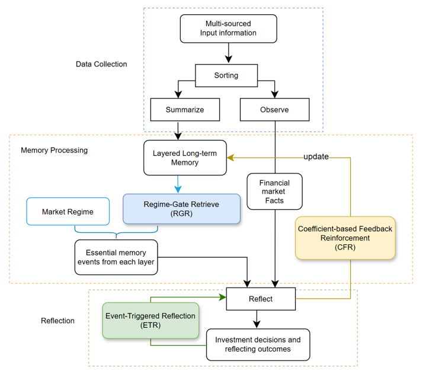
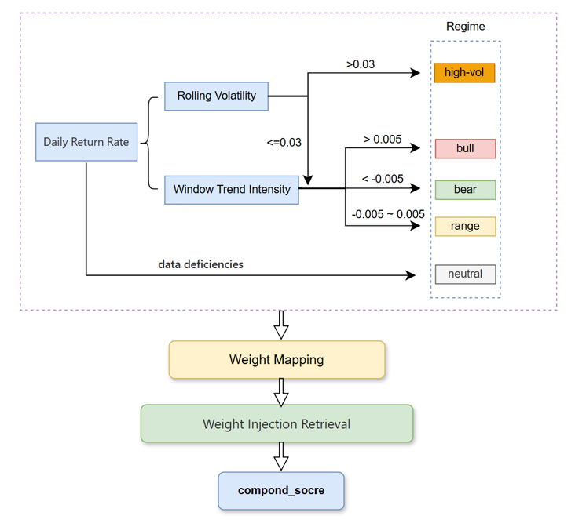
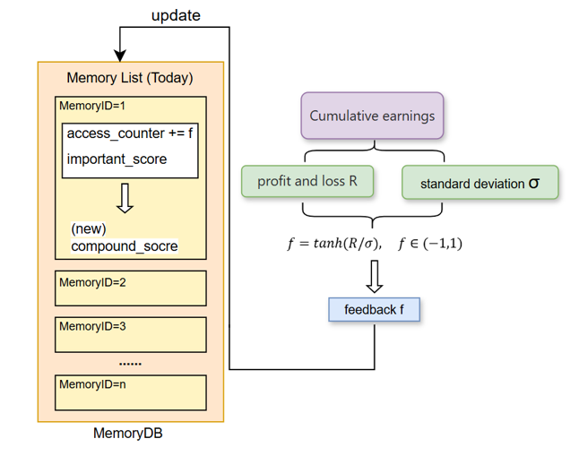
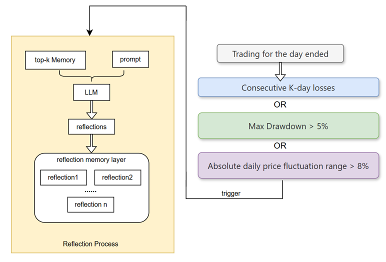
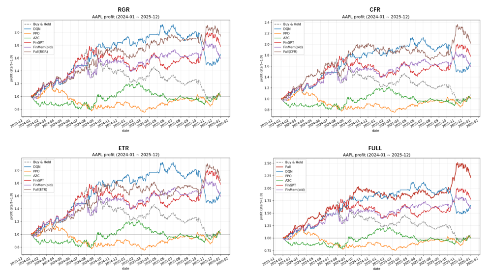
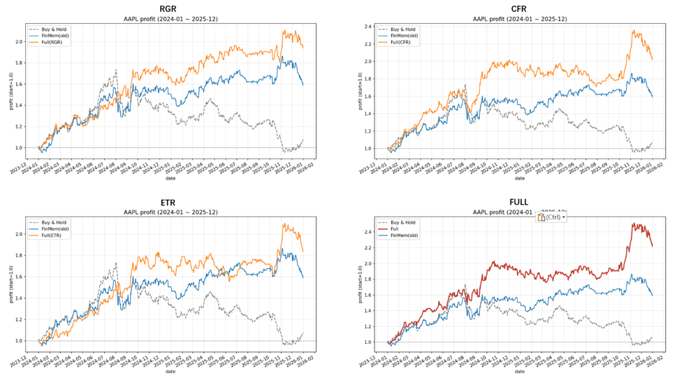
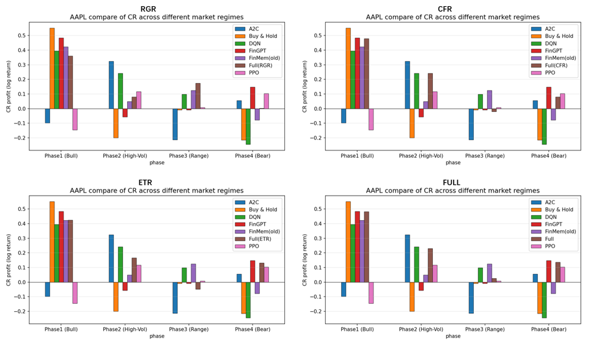

# Adaptive-FinMem-LLM-StockTrading

> Market-Regime Adaptive Memory Management for LLM-Based Stock Trading Agents

## Overview

This project extends the open-source **FinMem** framework with a
market-regime adaptive memory management mechanism for LLM-based
stock trading agents.

**Base Project:**  
[FinMem: A Performance-Enhanced LLM Trading Agent with Layered Memory and Character Design](https://github.com/pipiku915/FinMem-LLM-StockTrading)

The original FinMem framework follows a
**Perception → Memory → Decision → Feedback** workflow.
Based on this architecture, this project introduces three lightweight
memory-management mechanisms:

- **RGR (Regime-Gated Retrieval)** — adapts memory retrieval according to market regimes.
- **CFR (Coefficient-based Feedback Reinforcement)** — provides continuous risk-adjusted feedback for memory updates.
- **ETR (Event-Triggered Reflection)** — triggers additional reflection under abnormal market conditions.

The goal is to make the agent's memory management more adaptive to
non-stationary market environments while preserving the original
FinMem workflow and compatibility.

---

## System Diagram
Together, these mechanisms form an adaptive memory loop:




The figure shows the original FinMem **Perception → Memory → Decision → Feedback** loop and clearly highlight where **RGR, CFR, and ETR** are introduced.

### RGR: Regime-Gated Retrieval

Dynamically adjusts memory retrieval weights based on the current market regime.
RGR identifies Bull, Bear, Range, and High-volatility states using rolling volatility and return trends, then adjusts the weights of semantic relevance, recency, and importance accordingly.

This enables the same query to retrieve different memories under different market conditions, replacing FinMem's fixed-weight retrieval with regime-aware retrieval.




### CFR: Coefficient-based Feedback Reinforcement

The original FinMem uses a discrete feedback signal of:

```text
{-1, 0, +1}
```

CFR converts this into a continuous risk-adjusted feedback signal based on trading returns and volatility:

```text
Feedback = tanh(Return / Volatility)
```

The resulting feedback strength is used to update memory importance, allowing the system to distinguish between trading experiences with different levels of effectiveness and risk.




### ETR: Event-Triggered Reflection

ETR supplements the regular reflection process with event-driven reflection.

Additional reflection is triggered when predefined risk events occur, including:

* Consecutive losses
* Significant drawdown
* Abnormal daily price fluctuations

This allows the agent to perform additional experience consolidation during high-risk market conditions without continuously increasing reflection frequency.




## Experiment

The framework is evaluated on historical **Apple Inc. (AAPL)** financial data.

The experimental environment integrates:

* Historical price data
* Financial news
* Financial reports
* Hierarchical memory
* FAISS-based semantic retrieval
* LLM-based trading decisions

The test period covers **2024–2025**.

The market is further divided into four representative stages:

| Stage                  | Period                       |
| ---------------------- | ---------------------------- |
| Bull Market            | Jan. 1, 2024 – Aug. 2, 2024  |
| High-Volatility Market | Aug. 3, 2024 – Dec. 31, 2024 |
| Range-bound Market     | Jan. 1, 2025 – Jun. 30, 2025 |
| Bear Market            | Jul. 1, 2025 – Dec. 31, 2025 |

These periods are used to examine the adaptability of the proposed memory mechanism under different market conditions.

---

## Baselines

The proposed **Full** model is compared with:

* Buy & Hold
* DQN
* PPO
* A2C
* FinGPT
* Original FinMem

Ablation variants are also evaluated:

* Full(RGR)
* Full(CFR)
* Full(ETR)
* Full = RGR + CFR + ETR

---

## Results

###
### Performance Comparison





The figure contains the cumulative net-worth curves from January 2024 to December 2025 for the baseline methods and the proposed variants. The thesis reports that the complete **Full** model achieves the strongest overall cumulative-return performance, while RGR and CFR provide particularly noticeable improvements among the individual modules.

---

## Ablation Study

The three mechanisms contribute to different aspects of performance.

* **CFR** provides the most pronounced contribution to return performance.
* **RGR** mainly contributes to downside-risk control and market adaptability.
* **ETR** provides additional support under high-risk and volatile conditions.
* Combining the three mechanisms produces the strongest overall performance.




The figure directly compares **Original FinMem, Full(RGR), Full(CFR), Full(ETR), and Full**, preferably using cumulative-return curves or a compact metric comparison.

---

## Market-Regime Analysis

To evaluate adaptation under changing market conditions, the test period is divided into:

```text
Bull
  ↓
High Volatility
  ↓
Range-bound
  ↓
Bear
```



This figure shows the performance of the proposed Full model and representative baselines across the four market stages, emphasizing how the adaptive memory mechanism behaves when the market regime changes.


# 🚀 Usage

The implementation follows the original **FinMem** workflow.

The proposed mechanisms are integrated into the existing FinMem framework, so the overall usage process remains essentially unchanged.

## Disclaimer

This project is intended for **research and educational purposes only**.

The reported results are historical backtesting results and should not be interpreted as financial advice or as a guarantee of future trading performance.
